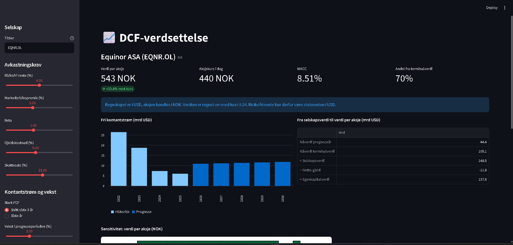
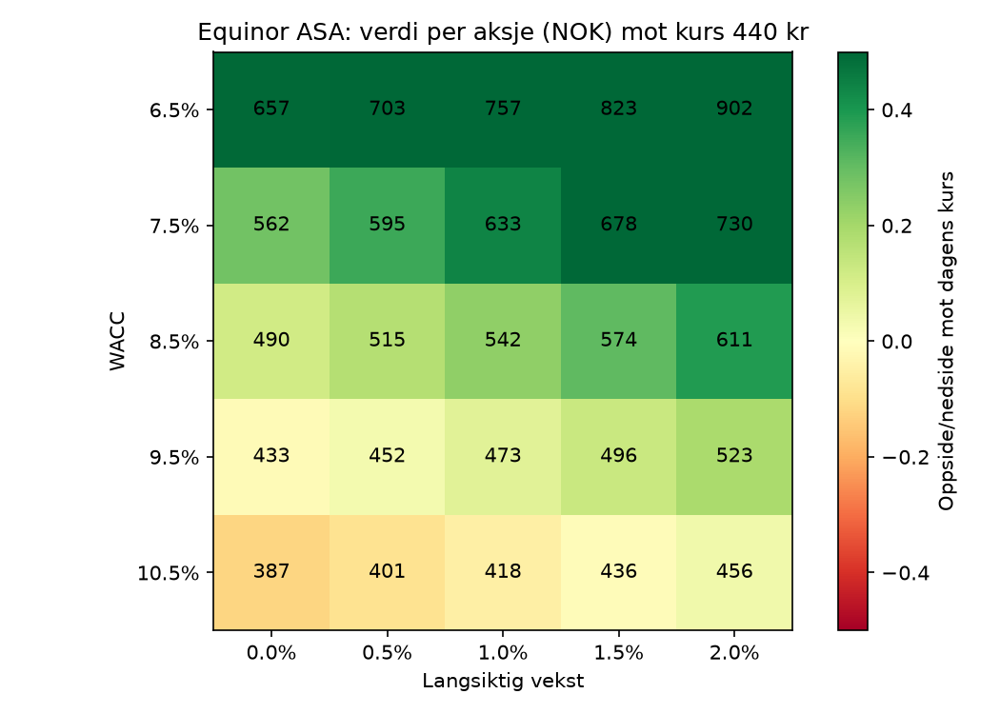

# DCF-verdsettelse av selskaper på Oslo Børs

Et verktøy i Python som verdsetter børsnoterte selskaper med en
diskontert kontantstrømmodell (DCF). Det henter regnskapsdata
automatisk og viser hvor følsom verdien er for forutsetningene.

**[Prøv appen her]([LENKE TIL APPEN])**



## Hva verktøyet gjør

- Henter regnskap, aksjekurs og valutakurs automatisk fra Yahoo Finance
- Beregner avkastningskrav med CAPM og WACC
- Fremskriver fri kontantstrøm og beregner terminalverdi med Gordons vekstmodell
- Regner om fra regnskapsvaluta til handelsvaluta (for eksempel USD til NOK for Equinor)
- Viser en sensitivitetsanalyse for WACC og langsiktig vekst
- Lar brukeren justere alle forutsetninger i en nettapp

## Metode

| Steg | Formel |
|---|---|
| Egenkapitalkostnad (CAPM) | kE = rf + β × MRP |
| WACC | E/V × kE + D/V × kD × (1 − t) |
| Fremskrevet kontantstrøm | FCFₜ = FCF₀ × (1 + g)ᵗ |
| Terminalverdi | TV = FCFₙ × (1 + g) / (WACC − g) |
| Verdi per aksje | (Selskapsverdi − netto gjeld) / antall aksjer |

Netto gjeld er beregnet som total gjeld minus kontanter og kortsiktige
finansielle investeringer.

## Eksempel: Equinor (EQNR.OL)

Analysen er gjort 23.10.2026 med beta 1,0, risikofri rente 4 %,
markedsrisikopremie 5 % og langsiktig vekst 1 %.

| Scenario | Start-FCF | Verdi per aksje | Mot kurs (438 kr) |
|---|---|---|---|
| Siste år (2025) | 6,0 mrd USD | 285 kr | −35 % |
| Snitt 2023–2025 | 10,6 mrd USD | 544 kr | +24 % |



**Funn:**

- **Valg av utgangspunkt avgjør resultatet.** Fri kontantstrøm falt fra
  26,4 mrd USD i 2022 til 6,0 mrd USD i 2025, etter de ekstraordinære
  gassprisene i 2022. Samme modell kan derfor vise både over- og
  underprising.
- **Markedet priser inn en implisitt WACC på rundt 10,5 %**, med snittet av
  de tre siste årene som grunnlag. Det er omtrent to prosentpoeng over
  modellens WACC, noe som kan tyde på at investorer krever en ekstra
  risikopremie for oljepris og energiomstilling.
- **Om lag 70 % av verdien kommer fra terminalverdien**, altså fra
  kontantstrømmer etter prognoseperioden. Det gjør resultatet svært
  følsomt for forutsetningene om langsiktig vekst og WACC.

## Forutsetninger og begrensninger

- **Beta:** Yahoo Finance oppgir en negativ beta for Equinor (−0,66), som
  ikke gir mening for et oljeselskap. Den skyldes trolig at betaen er
  målt mot en amerikansk indeks mens aksjen handles i NOK. Modellen
  bruker derfor beta 1,0 som standard.
- **Valuta:** Når regnskapet er i USD, må også risikofri rente være
  amerikansk statsrente, slik at kontantstrøm og avkastningskrav er i
  samme valuta.
- **Banker og forsikring:** Fri kontantstrøm gir lite mening for
  finansinstitusjoner, der utlån og innskudd er en del av driften. Andre
  modeller, som utbyttemodellen, passer bedre for dem.
- **Konstant vekst:** Modellen bruker én vekstrate i hele
  prognoseperioden.
- **Datakvalitet:** Tallene fra Yahoo Finance er ikke kontrollert mot
  selskapenes årsrapporter.

Verktøyet er laget for læring og er ikke investeringsråd.

## Testing

Formlene er testet med 16 automatiske tester (pytest) mot svar regnet
for hånd, blant annet spesialtilfeller som evig annuitet og WACC uten
gjeld.

```
pytest
```

## Kjør prosjektet selv

```
git clone https://github.com/[BRUKERNAVN]/dcf-oslo-bors.git
cd dcf-oslo-bors
python -m venv .venv
.venv\Scripts\activate
pip install -r requirements.txt
streamlit run app.py
```

## Struktur

```
dcf-oslo-bors/
├── src/
│   ├── data.py            Henter og rydder data fra Yahoo Finance
│   └── dcf.py             CAPM, WACC, nåverdi, terminalverdi, sensitivitet
├── tests/
│   └── test_dcf.py        Automatiske tester
├── app.py                 Streamlit-app
├── sjekk_dcf.py           Kjører modellen i terminalen
└── sjekk_sensitivitet.py  Lager sensitivitetstabell og varmekart
```

## Teknologi

Python · pandas · NumPy · Matplotlib · Streamlit · yfinance · pytest

## Om meg

Jorgensandvaer, student i økonomi og administrasjon ved BI
Handelshøyskolen. Jørgen Foss Sandvær (https://www.linkedin.com/in/j%C3%B8rgen-foss-sandv%C3%A6r-0383633b3/)